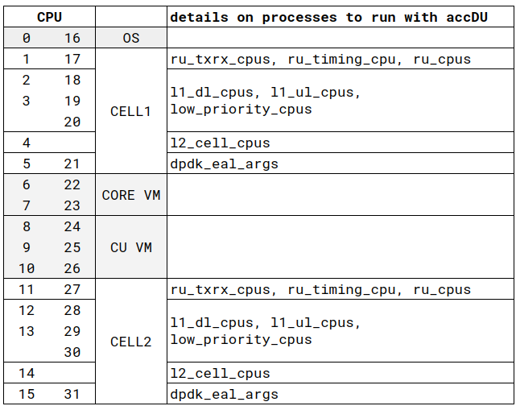

# Server preparation

- This guide will try deploying below example:
<p align="center">
  
</p>

- Also, below CPU allocation would be used:
<p align="center">
  
</p>

> PS:

> - This is based on the `AMD Ryzen 9 7950X 16-Core Processor` used with the lab super micro servers. But depending on the CPU this might be different.
> - This is intended to be used for single machine setups for testing purposes. (Customer setups would have a seperate machine to run the CU/RIC/CORE). Then the 10 CPUs allocated to the CORE and CU VM in above table will be used for CELL-3.


## 1. Update GRUB on DU server

- Update the grub configuration: Edit `/etc/default/grub` file to include below:
```bash
GRUB_CMDLINE_LINUX_DEFAULT="quiet splash hugepagesz=1G hugepages=4 hugepagesz=2M hugepages=0 default_hugepagesz=1G amd_iommu=on iommu=pt rcu_nocb_poll rcu_nocbs=1-15,17-31 nohz=on nohz_full=1-15,17-31 kthread_cpus=0,16 rcutree.kthread_prio=99 irqaffinity=0,16"
GRUB_CMDLINE_LINUX="selinux=0 enforcing=0 nmi_watchdog=0 crashkernel=auto softlockup_panic=0 nosoftlockup audit=0 mce=off tsc=nowatchdog skew_tick=1"
GRUB_FLAVOUR_ORDER="realtime"
```
- To Apply run below:
```bash
sudo update-grub2 
```

## 2. Prepare the Machine for RealTime Performance

- Install lowlatency kernel
```bash
sudo apt update
sudo apt install linux-realtime tuna
sudo apt remove linux-image-generic
sudo apt autoremove
```

- Update CPUAffinity:
    - Update `/etc/systemd/system.conf` with:
```bash
CPUAffinity=0,16
```
    - Set the systemd system slice CPU affinity
```bash
sudo systemctl set-property system.slice AllowedCPUs=0,16
sudo systemctl set-property user.slice AllowedCPUs=1-15,17-31
sudo systemctl daemon-reload
```
- Prepare `rc.local` service to automate initial setup after reboot.
    - Download [init.sh](init.sh) in `~/accelleran/scripts/init.sh`.
    - Run:
```bash
cd ~/accelleran/scripts
chmod +x init.sh
sudo ./init.sh
```

- Remove unnecessary systemd units:
```bash
sudo systemctl disable irqbalance.service multipathd.service multipathd.socket snapd.service snapd.socket unattended-upgrades.service ufw.service systemd-timesyncd.service ModemManager.service motd-news.timer bluetooth.service ntp.service
```

- Reboot server for the changes to take effect
```bash
sudo reboot
```

## 3. Prepare Timing
- Follow details in [link](/drax-docs/du-ru_sync_options/2024.1.0/)

## 4. Prepare Virtual Functions

- Create Virtual Function Interfaces on your Server to be used later on by the CU and CORE VMs.
- Make sure the server interface can support Virtual Functions. This is by checking if the NIC can allow SR_IOV. More details mentioned [here](../../../extra_info/index.md)
```bash
sudo lspci -vvv | less 
cat /sys/class/net/enp2s0f1/device/sriov_numvfs
```
- Assuming the above is valid, virtual-functions can be created by editing the netplan to include below:
```bash
network:
  ethernets:
    enp2s0f1:
      virtual-function-count: 4
```
- After applying this, new interfaces would appear on the server. (enp2s0f1v0, enp2s0f1v1, enp2s0f1v2, enp2s0f1v3). Update the netplan again to include the IP to be used by the DU on one of these interfaces.
```bash
network:
  ethernets:
    enp2s0f1v2:
      addresses:
      - 10.55.5.5/24
```
> With accDU remember to create one VF for each fronthault interface.

## 5. Create Virtual Machines

Use below steps to create two VMs on the machine and connect it to the baremetal server.

- Install virt-manager on the baremetal server
```bash
sudo apt install virt-manager
```
- Download ubuntu22.04 server iso. (example below command)
```bash
curl -O https://releases.ubuntu.com/22.04.4/ubuntu-22.04.4-live-server-amd64.iso
```

#### Using virt-manager GUI

- ssh into the baremetal server using -X. and fire up virt-manager
```bash
ssh -X username@10.55.5.2
virt-manager
```
- Follow the steps and vreate the VM using ubuntu 22.04 server iso, Keep in mind:
    - The VM would be using cores other than those isolated for the DU in section 1.2 above.
        - To achieve this make sure to click on `Customise configuration before install`
        <p align="center">
        
        </p>
        - Edit the XML to change the cpu line to be as below for the CU VM:
        ```
          <vcpu placement="static" cpuset="8-10,24-26">6</vcpu>
          <cputune>
            <vcpupin vcpu="0" cpuset="8"/>
            <vcpupin vcpu="1" cpuset="9"/>
            <vcpupin vcpu="2" cpuset="10"/>
            <vcpupin vcpu="3" cpuset="24"/>
            <vcpupin vcpu="4" cpuset="25"/>
            <vcpupin vcpu="5" cpuset="26"/>
          </cputune>
        ```
        - For the CORE VM:
        ```
          <vcpu placement="static" cpuset="6-7,22-23">4</vcpu>
          <cputune>
            <vcpupin vcpu="0" cpuset="6"/>
            <vcpupin vcpu="1" cpuset="7"/>
            <vcpupin vcpu="2" cpuset="22"/>
            <vcpupin vcpu="3" cpuset="23"/>
          </cputune>
        ```
        - Remove default created NIC device and then from `Add Hardware` -> `PCI Host Device` select the Virtual function created for this virtual machine.
        <p align="center">
        
        </p>    
        - The below should be the default , but Please make sure the CPU configuration is using "host-passthough".
        <p align="center">
        
        </p>    


## 5. Install Docker

From (https://docs.docker.com/engine/install/ubuntu/#install-using-the-repository)

```bash
sudo apt-get update
sudo apt-get install ca-certificates curl gnupg
sudo install -m 0755 -d /etc/apt/keyrings
curl -fsSL https://download.docker.com/linux/ubuntu/gpg | sudo gpg --dearmor -o /etc/apt/keyrings/docker.gpg
sudo chmod a+r /etc/apt/keyrings/docker.gpg
echo \
  "deb [arch="$(dpkg --print-architecture)" signed-by=/etc/apt/keyrings/docker.gpg] https://download.docker.com/linux/ubuntu \
  "$(. /etc/os-release && echo "$VERSION_CODENAME")" stable" | \
  sudo tee /etc/apt/sources.list.d/docker.list > /dev/null
sudo apt-get update
sudo apt-get install docker-ce docker-ce-cli containerd.io docker-buildx-plugin docker-compose-plugin docker-compose

sudo usermod -aG docker $USER
```

- logout and login for the last command to take effect

```bash
sudo mkdir /etc/docker
sudo tee /etc/docker/daemon.json <<EOF
{
  "exec-opts": ["native.cgroupdriver=systemd"],
  "log-driver": "json-file",
  "log-opts": {
    "max-size": "100m"
  },
  "storage-driver": "overlay2"
}
EOF
sudo systemctl enable docker
sudo systemctl daemon-reload
sudo systemctl restart docker
```

- Optionally, one can update docker-compose to the latest version. (It might be needed in cases when to operate the cell without the cell-wrapper). More information can be found in [link](https://docs.docker.com/compose/install/linux/#install-the-plugin-manually)

```bash
DOCKER_CONFIG=${DOCKER_CONFIG:-$HOME/.docker}
mkdir -p $DOCKER_CONFIG/cli-plugins
curl -SL https://github.com/docker/compose/releases/download/v2.29.7/docker-compose-linux-x86_64 -o $DOCKER_CONFIG/cli-plugins/docker-compose
sudo chmod +x $DOCKER_CONFIG/cli-plugins/docker-compose
# to overwite the version installed in earlier
sudo cp $DOCKER_CONFIG/cli-plugins/docker-compose /usr/bin/.
```

## 6. Vendor Specific Steps
* [AccelleranDU Preparation](/drax-docs/accelleran_benetel/2.0.2/)
