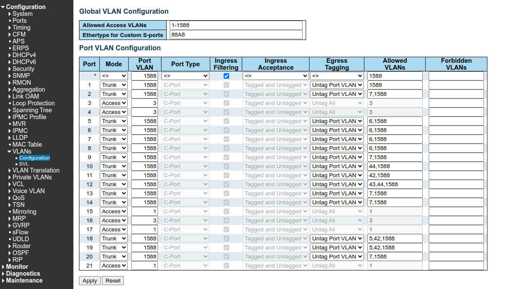
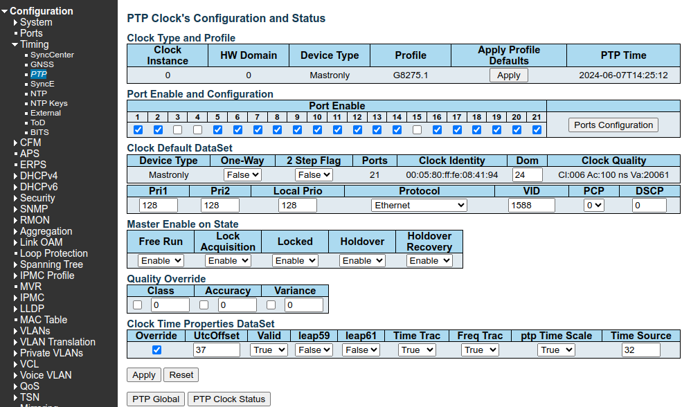
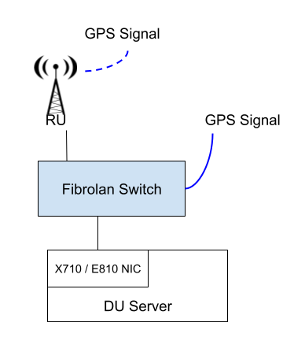
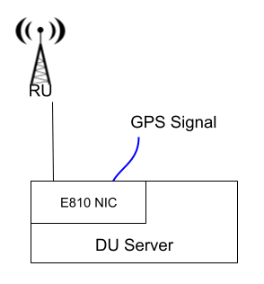
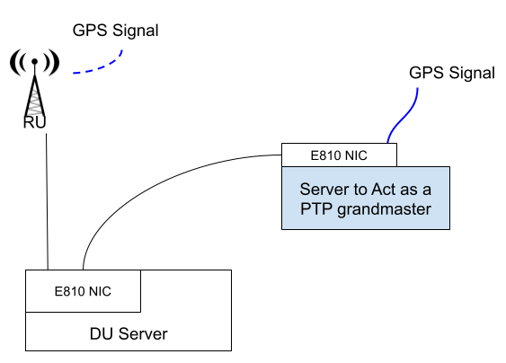

# **DU-RU Timing Synchronization**

Depending on the setup and the available infrastructure there might be multiple options to provide the timing synchronization needed to run the 5G cell.

> PS: This section will focus on RAN3 where the DU server will need to be synced. This won't be necessary with RAN1, which only require the RU to be synced (PTP, 1PPS, or GPS can be used dependong the RU)

## **1. Using Fibrolan Switch Between the DU and RU**

### 1.1. Requirement

- Fronthaul Switch configured properly to run as PTP Grandmaster source.
- X710 or E810 card on the DU server to run PTP and DPDK for the fronthaul.

#### Fibrolan Configuration

> PS: Assuming VLAN ID 6 would be used for this testing setup.

- Make sure the Switch is connected to GPS source
- Configrure the VLAN Allowed for the Ports connected to the DU Side and The RU
  - (With Fibrolan Falcon Switch): Configuration -> VLANs -> Configuration. (as below image)
    - Mode: Trunk
    - Port VLAN: 1588
    - Egress Tagging: Untag Port VLAN 
    - Allowed VLANs: 1588,6
    <p align="center">
    
    </p>

- Configure PTP Clock:
  - (With Fibrolan Falcon Switch): Configuration -> Timing -> PTP (as below image)
    - Create/Edit a lock. (Profile G8275.1)
    - Select the Ports towards the DU and RU
    - Dom: 24
    - VID: 1588
    <p align="center">
    
    </p>


### 1.2. DU Server Configuration

#### 1.2.1. Setup

- The DU-RU connection would be similar to below:

<p align="center">
  
</p>

#### 1.2.2. Software to Install
- Install linuxptp
```bash
sudo apt install linuxptp
```

#### 1.2.3. Prepare and Start The Sync Services

> Assuming the interface connected to the switch is "eno1"

- Edit `/lib/systemd/system/phc2sys@.service` to look as this example: [phc2sys@.service](templates/phc2sys/phc2sys@.service)
- Edit `/lib/systemd/system/ptp4l@.service` to look as this example: [ptp4l@.service](templates/ptp4l/ptp4l@.service)
- Edit `/etc/linuxptp/ptp4l.conf` domainNumber to be 24.
- Enable and start the services:
```bash
sudo systemctl daemon-reload
sudo systemctl start ptp4l@eno1
sudo systemctl enable ptp4l@eno1
sudo systemctl start phc2sys@eno1
sudo systemctl enable phc2sys@eno1
```

## **2. Using E810 Card with GPS on the same server**

### 2.1. Requirement

- E810 card on the DU server to run PTP and DPDK for the fronthaul.
- GPS signal provided to the NIC Card

### 2.2. Configuration

#### 2.2.1. Setup

- The DU-RU connection would be similar to below:

<p align="center">
  
</p>

#### 2.2.2. Software to Install

> PS: As this is using the E810 card newer version of PTP would be needed (currently tested with 4.3)

- Install PTP

```bash
cd ~/accelleran/installation_files/
git clone --branch=v4.3 git://git.code.sf.net/p/linuxptp/code linuxptp
cd linuxptp/
sudo make
sudo make install
sudo ldconfig
```

- Install new ICE driver for E810

```bash
mkdir -p ~/accelleran/installation_files/E810_NIC
cd ~/accelleran/installation_files/E810_NIC
wget https://downloadmirror.intel.com/825841/ice-1.14.11.tar.gz
tar -xzf  ice-1.14.11.tar.gz
cd ice-1.14.11/src
sudo apt install linux-headers-$(uname -r)
sudo apt install make gcc
sudo make -j install
sudo ldconfig
sudo insmod ./intel_auxiliary.ko
sudo modprobe gnss
sudo insmod ./ice.ko
```

- Install new IAVF driver for E810 VirtualFunctions

```bash
cd ~/accelleran/installation_files/E810_NIC
wget https://downloadmirror.intel.com/825844/iavf-4.11.2.tar.gz
tar -xzf  iavf-4.11.2.tar.gz
cd iavf-4.11.2/src
sudo make -j install
sudo ldconfig
```

- Reboot server for these changes to take effect

```bash
reboot
```

- Update Firmware for E810 Card

```bash
cd ~/accelleran/installation_files/E810_NIC
wget https://download.mitacmct.com/Files/download/Intel-DSG/software/SUPID/19626/4.50/E810_NVMUpdatePackage_v4_50_Linux.tar.gz
tar -xzf  E810_NVMUpdatePackage_v4_50_Linux.tar.gz
cd E810/Linux_x64/
sudo ./nvmupdate64e -u -l -c nvmupdate.cfg
```

- Reboot server for these changes to take effect

```bash
reboot
```

**Validate Everything is OK**

- Check version of PTP

```bash
$ ptp4l -v
4.3
```

- Check firmare of the card

```bash
$ ethtool -i enp1s0f0
driver: ice
version: 1.14.11
firmware-version: 4.50 0x8001d8bb 1.3597.0
expansion-rom-version: 
bus-info: 0000:01:00.0
supports-statistics: yes
supports-test: yes
supports-eeprom-access: yes
supports-register-dump: yes
supports-priv-flags: yes
```

- Check GNSS is supported

```bash
$ ls -R /sys/class/ptp/*/pins/
/sys/class/ptp/ptp0/pins/:
SDP0  SDP1  SDP2  SDP3

/sys/class/ptp/ptp1/pins/:
SDP0  SDP1  SDP2  SDP3

/sys/class/ptp/ptp2/pins/:
GNSS  SMA1  SMA2  U.FL1  U.FL2
```

- After connecting the GPS connection , check if GPS signal is being received

```bash
$ sudo cat /dev/gnss0
$GNRMC,134932.00,A,5112.82237,N,00425.39008,E,0.066,,170724,,,A,V*17
$GNGGA,134932.00,5112.82237,N,00425.39008,E,1,09,0.93,62.9,M,46.1,M,,*7B
$GNRMC,134933.00,A,5112.82236,N,00425.39004,E,0.066,,170724,,,A,V*1B
$GNGGA,134933.00,5112.82236,N,00425.39004,E,1,09,0.93,63.0,M,46.1,M,,*7F
$GNRMC,134934.00,A,5112.82237,N,00425.39003,E,0.065,,170724,,,A,V*19
```

#### 2.2.3. Prepare and Start The Sync Services

**ts2phc**

> Assuming the first interface on the E810 card is "enp1s0f0"

- Create `~/accelleran/config_files/ts2phc.cfg` to look as this example: [ts2phc.cfg](templates/ts2phc/ts2phc.cfg)
- Create `/lib/systemd/system/ts2phc.service` to look as this example: [ts2phc.service](templates/ts2phc/ts2phc.service)
- start service
```bash
sudo systemctl daemon-reload
sudo systemctl start ts2phc.service
sudo systemctl enable ts2phc.service
sudo systemctl status ts2phc.service
```
- to verify

```bash
$ journalctl -f | grep ts2phc
Jul 17 14:49:52 super3 ts2phc[21316]: ts2phc[5636.703]: /dev/ptp2 offset          0 s2 freq      -0
Jul 17 14:49:53 super3 ts2phc[21316]: ts2phc[5637.703]: /dev/ptp2 offset          0 s2 freq      -0
Jul 17 14:49:54 super3 ts2phc[21316]: ts2phc[5638.703]: /dev/ptp2 offset          0 s2 freq      -0
```

**phc2sys**

> Assuming the first interface on the E810 card is "enp1s0f0"

- Stop NTP service
```bash
sudo timedatectl status
sudo timedatectl set-ntp false
sudo timedatectl status
```

- Create and edit `/lib/systemd/system/phc2sys.service` to look as this example: [phc2sys.service](templates/phc2sys/phc2sys.service)

- start service

```bash
sudo systemctl daemon-reload
sudo systemctl start phc2sys.service
sudo systemctl enable phc2sys.service
sudo systemctl status phc2sys.service
```

- to verify

```bash
$ journalctl -f | grep phc2sys
Jul 17 15:07:13 super3 phc2sys[21626]: phc2sys[6677.419]: CLOCK_REALTIME rms   14 max   28 freq  +1675 +/-  14 delay   518 +/-  21
Jul 17 15:07:13 super3 phc2sys[21626]: [6677.419] CLOCK_REALTIME rms   14 max   28 freq  +1675 +/-  14 delay   518 +/-  21
Jul 17 15:07:15 super3 phc2sys[21626]: phc2sys[6678.921]: CLOCK_REALTIME rms   10 max   19 freq  +1654 +/-  15 delay   524 +/-  10
Jul 17 15:07:15 super3 phc2sys[21626]: [6678.921] CLOCK_REALTIME rms   10 max   19 freq  +1654 +/-  15 delay   524 +/-  10
Jul 17 15:07:16 super3 phc2sys[21626]: phc2sys[6680.423]: CLOCK_REALTIME rms    7 max   14 freq  +1672 +/-   7 delay   531 +/-   8
Jul 17 15:07:16 super3 phc2sys[21626]: [6680.423] CLOCK_REALTIME rms    7 max   14 freq  +1672 +/-   7 delay   531 +/-   8
Jul 17 15:07:18 super3 phc2sys[21626]: phc2sys[6681.924]: CLOCK_REALTIME rms    6 max   13 freq  +1663 +/-   7 delay   529 +/-   8
Jul 17 15:07:18 super3 phc2sys[21626]: [6681.924] CLOCK_REALTIME rms    6 max   13 freq  +1663 +/-   7 delay   529 +/-   8
```

**ptp4l**

> Assuming the fronthaul interface towards the RU on the E810 card is "enp1s0f1"

- Create and edit `~/accelleran/config_files/ptp4l.cfg` to look as this example: [ptp4l.cfg](templates/ptp4l/ptp4l.cfg)
- Create and edit `/lib/systemd/system/ptp4l.service` to look as this example: [ptp4l.service](templates/ptp4l/ptp4l.service)

- start service

```bash
sudo systemctl daemon-reload
sudo systemctl start ptp4l.service
sudo systemctl enable ptp4l.service
sudo systemctl status ptp4l.service
```

- to verify

```bash
$ journalctl -f -n 10 | grep ptp4l | grep enp1s0f1
Jul 17 15:15:03 super3 ptp4l[21775]: ptp4l[7147.610]: port 1 (enp1s0f1): assuming the grand master role
```

## **3. Using E810 on the DU server with CU server acting as GM**

### 3.1. Requirement

- E810 card on the DU server to run PTP and DPDK for the fronthaul.
- E810 card on the CU server to act as PTP GM
- GPS signal provided to the NIC Card

### 3.2. Configuration

#### 3.2.1. Setup

- The DU-RU connection would be similar to below:

<p align="center">
  
</p>

#### 3.2.2. Software to Install

> PS: As this is using the E810 card newer version of PTP would be needed (currently tested with 4.3)

- Follow the same steps as in **section 2.2.2** above to install ptp4l v4.3 and the E810 drivers on both DU and CU servers.


#### 3.2.3. Prepare and Start The Sync Services on the CU server

- Follow the same steps as in **section 2.2.3** above to configure the CU server as PTP grandmaster

#### 3.2.4. Prepare and Start The Sync Services on the DU server


**phc2sys**

> Assuming the interface with PTP coming from the CU server is "enp1s0f0"

- Stop NTP service
```bash
sudo timedatectl status
sudo timedatectl set-ntp false
sudo timedatectl status
```

- Create and edit `/lib/systemd/system/phc2sys.service` to look as this example: [phc2sys.service](templates/phc2sys/phc2sys.service)

- start service

```bash
sudo systemctl daemon-reload
sudo systemctl start phc2sys.service
sudo systemctl enable phc2sys.service
sudo systemctl status phc2sys.service
```

- to verify

```bash
$ journalctl -f | grep phc2sys
Jul 17 15:07:13 super3 phc2sys[21626]: phc2sys[6677.419]: CLOCK_REALTIME rms   14 max   28 freq  +1675 +/-  14 delay   518 +/-  21
Jul 17 15:07:13 super3 phc2sys[21626]: [6677.419] CLOCK_REALTIME rms   14 max   28 freq  +1675 +/-  14 delay   518 +/-  21
Jul 17 15:07:15 super3 phc2sys[21626]: phc2sys[6678.921]: CLOCK_REALTIME rms   10 max   19 freq  +1654 +/-  15 delay   524 +/-  10
Jul 17 15:07:15 super3 phc2sys[21626]: [6678.921] CLOCK_REALTIME rms   10 max   19 freq  +1654 +/-  15 delay   524 +/-  10
Jul 17 15:07:16 super3 phc2sys[21626]: phc2sys[6680.423]: CLOCK_REALTIME rms    7 max   14 freq  +1672 +/-   7 delay   531 +/-   8
Jul 17 15:07:16 super3 phc2sys[21626]: [6680.423] CLOCK_REALTIME rms    7 max   14 freq  +1672 +/-   7 delay   531 +/-   8
Jul 17 15:07:18 super3 phc2sys[21626]: phc2sys[6681.924]: CLOCK_REALTIME rms    6 max   13 freq  +1663 +/-   7 delay   529 +/-   8
Jul 17 15:07:18 super3 phc2sys[21626]: [6681.924] CLOCK_REALTIME rms    6 max   13 freq  +1663 +/-   7 delay   529 +/-   8
```

**ptp4l**

> Assuming the fronthaul interface towards the RU on the E810 card is "enp1s0f1" and interface with PTP coming from CU is "enp1s0f0"

- Create and edit `~/accelleran/config_files/ptp4l.cfg` to look as this example: [ptp4l.cfg](templates/ptp4l/ptp4l-BC.cfg)
- Create and edit `/lib/systemd/system/ptp4l.service` to look as this example: [ptp4l.service](templates/ptp4l/ptp4l.service)

- start service

```bash
sudo systemctl daemon-reload
sudo systemctl start ptp4l.service
sudo systemctl enable ptp4l.service
sudo systemctl status ptp4l.service
```
