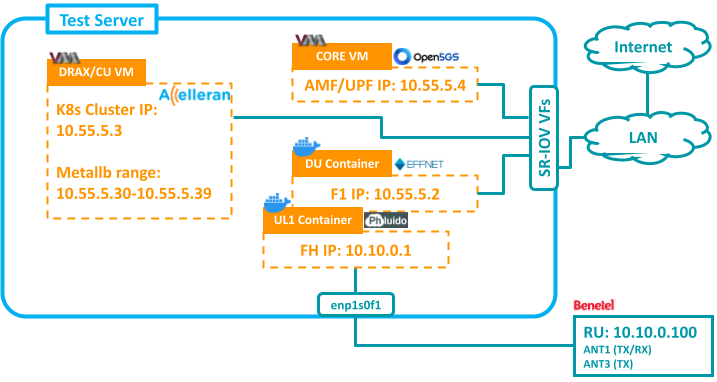

# RAN1: Effnet-Phluido-Benetel

> PS: All the following steps and sections won't be needed in case of using ansible. Guide available in [5G Integration Repo](https://github.com/accelleran/5g-integration/tree/main/utilities/install_tools/ansible)


| RAN | Component | Version |
|-|-|-|
| RAN1 | Effnet DU | 2024-06-14-q3-patch-release-02-8.9.3 |
| RAN1 | Phluido UL1 | 8.12.1 |
| RAN1 | BNTL650-CATB| RAN650-2V0.8.1 |
| RAN1 | BNTL550-CATB | RAN550-2-V0.8.1 |

<p align="center">
  
</p>

## 1. DU Side Changes

## 1.1. DU/L1 Images

- Make sure to login to docker on the DU server with a username that has access to dockerhub
```bash
docker login
```

- Optionaly, one can pull the images manually. (This will be done automatically with the cell wrapper)
```bash
docker pull accelleran/phluido-l1:v8.12.1
docker pull accelleran/effnet-du-phluido:2024-06-14-q3-patch-release-02-8.9.3
```

## 1.2. Effnet License

- Make sure a yubikey is connected to the server and then run below:
```bash
docker pull accelleran/effnet-pcscd-yubikey:v1.0.0
docker run --restart always -id --privileged --name pcscd_yubikey_c -v /run/pcscd:/run/pcscd accelleran/effnet-pcscd-yubikey:v1.0.0
```

- If a new license is to be loaded on the key, Use the activation file provided by effnet to run below:
```bash
unzip effnet-license-activation-2023-06-29_01.zip
cd effnet-license-activation-2023-06-29_01
bunzip2 --stdout effnet-license-activation-2023-06-29.tar.bz2 | docker load
docker run -it --rm -v /var/run/pcscd:/var/run/pcscd effnet/license-activation-2023-06-29
```

## 1.3. Fronthaul Preperation

- Assuming the RU is connected to enp1s0f1 and the RU is using the default IP `10.10.0.100`
- Edit the DU server netplan to include below:
```bash
network:
  ethernets:
    enp1s0f1:
      addresses:
      - 10.10.0.1/24
      mtu: 9000
```
- Apply netplan and validate that the RU is reachable
```bash
sudo netplan apply 
ping 10.10.0.100
```

## 2. RU Side Changes

### 2.1. Set DU MAC Address

- Check the Fronthaul interface MAC address on the DU server side.
```bash
ifconfig enp1s0f1
```

- ssh into the RU and set the DU MAC with EEPROM. (assuming the mac address was `7c:c2:55:69:f8:eb`)
```bash
echo -n "0-0057" > /sys/bus/i2c/devices/0-0057/driver/unbind
registercontrol -w 0xC036B -x 0x88000088
eeprog_cp60 -f -x -16 /dev/i2c-0 0x57 -w 0x1a:0x01:0x7c
eeprog_cp60 -f -x -16 /dev/i2c-0 0x57 -w 0x1b:0x01:0xc2
eeprog_cp60 -f -x -16 /dev/i2c-0 0x57 -w 0x1c:0x01:0x55
eeprog_cp60 -f -x -16 /dev/i2c-0 0x57 -w 0x1d:0x01:0x69
eeprog_cp60 -f -x -16 /dev/i2c-0 0x57 -w 0x1e:0x01:0xf8
eeprog_cp60 -f -x -16 /dev/i2c-0 0x57 -w 0x1f:0x01:0xeb
registercontrol -w 0xC036B -x 0x88000488
```
- Verify by running:
```bash
eeprog_cp60 -q -f -x -16 /dev/i2c-0 0x57 -x -r 26:6
```
- Reboot the RU to apply the change


## 3. Extra Info

More Details can be found on Confluence:

- [effnetDU](https://accelleran.atlassian.net/wiki/x/HwBzk)
- [phluidoL1](https://accelleran.atlassian.net/wiki/x/JQB1k)
- [benetelRU](https://accelleran.atlassian.net/wiki/x/C4BLlQ)

### 3.1. Load testing DU Image

> This section is only needed when the image is not available on dockerhub.

- Copy the file containing the image to the server. (example file accelleran-du-phluido-2024-01-31-q3-patch-release-01-8.9.3.zip)
- Load image
```bash
sudo apt install unzip
unzip accelleran-du-phluido-2024-01-31-q3-patch-release-01-8.9.3.zip
cd accelleran-du-phluido-2024-01-31-q3-patch-release-01-8.9.3
bzcat gnb_du_main_phluido-2024-01-31-q3-patch-release-01-8.9.3.tar.bz2 | docker image load
```
- Validate that the docker image was loaded and take note of the image tag
```bash
docker images
```

### 3.2. Load testing UL1 Image

> This section is only needed when the image is not available on dockerhub.

- Copy the binary of the UL1 into the server. (example file for v8.12.1 was named PhluidoUL1_NR)
- Prepare files. (Use the date of the installation) and then load image
```bash
mkdir Phluido5GL1_v8.12.1
cd Phluido5GL1_v8.12.1
mv <path_to_the_new_binary> PhluidoUL1_NR
chmod +x PhluidoUL1_NR
echo "2024-01-01, 12:00:00" > L1_NR_copyright
tee Dockerfile.l1 <<EOF
FROM ubuntu:22.04

COPY PhluidoUL1_NR /
COPY L1_NR_copyright /root/.Phluido/L1_NR_copyright

ENTRYPOINT ["/PhluidoUL1_NR"]
EOF
cd ..
docker build -f Phluido5GL1_v8.12.1/Dockerfile.l1 -t phluido_l1:v8.12.1 Phluido5GL1_v8.12.1
```
- Validate that the docker image was loaded and take note of the image tag
```bash
docker images
```
