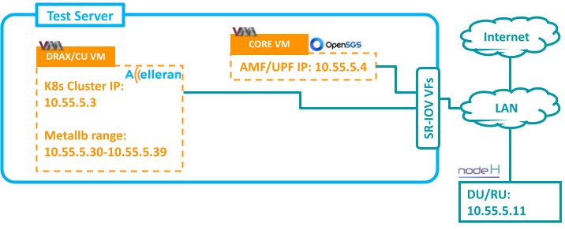

# RAN2: NodeHDU-T&W/Askey

> PS: All the following steps and sections won't be needed in case of using ansible. Guide available in [5G Integration Repo](https://github.com/accelleran/5g-integration/tree/main/utilities/install_tools/ansible)


<p align="center">
  
</p>

## DU Side Changes

Generally the Unit received from nodeh with DHCP configured on all ports.
- Using netplan update the interface to be used with a static IP. Example below:
```bash
$ cat /etc/netplan/01-netcfg.yaml 
network:
        version: 2
        renderer: networkd
        ethernets:
                eth1:
                        dhcp4: yes
                eth2:
                        dhcp4: yes
                        addresses: [10.55.7.11/24]
                        gateway4: 10.55.7.1
                        nameservers:
                                addresses: [8.8.8.8,8.8.4.4]
```

In case the main interface used by the unit to be changed (e.g. using the fiber interface instead of ethernet)
- Below file will need to be updated accordingly
```bash
$ cat /opt/nodeh/etc/config.json
{
 "DbInit": {
   "Factory": "/opt/nodeh/etc/datamodel_autogenerated.json",
   "DataUpdate0": "/etc/nodeh/unitdata/fap_config.json",
   "DataUpdate1": "/var/lib/nodeh/data/fap_config_si.json"
 },
 "General":{
   "EthernetIf": "eth1"
 }
}
```

Make sure to add the public key of the cell wrapper to the unit authorized keys in `.ssh/authorized_keys`
