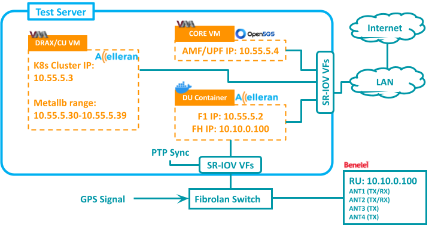

# RAN3: AccelleranDU-Benetel

> PS: All the following steps and sections won't be needed in case of using ansible. Guide available in [5G Integration Repo](https://github.com/accelleran/5g-integration/tree/main/utilities/install_tools/ansible)


| RAN | Component | Version |
|-|-|-|
| RAN3 | Accelelran DU | 3.0.1 |
| RAN3 | BNTL650-CATA | RAN650-1v1.0.4-dda1bf5 |
| RAN3 | BNTL550-CATA | RAN550-1v1.0.4-605a25a |

<p align="center">
  
</p>

## 1. DU Server Changes

- Make sure to add the public key of the cell wrapper to the server's authorized keys in `.ssh/authorized_keys`

### 1.1. Sync DU Server with PTP

There are multiple options to sync the RU and DU

- Details on this can be found in [DU-RU Timing Synchronization](../../du-ru_sync_options/2024.1.0/index.md)

### 1.2. DPDK and Fronthaul Preperation

- Install DPDK 23.11
```bash
mkdir -p ~/accelleran/installation_files
sudo apt update
sudo apt -y install build-essential tar wget
sudo apt -y install python3-pip libnuma-dev meson ninja-build python3-pyelftools
cd ~/accelleran/installation_files
wget https://fast.dpdk.org/rel/dpdk-23.11.tar.xz
tar xvf dpdk-23.11.tar.xz dpdk-23.11/
cd dpdk-23.11/ && sudo meson setup build
cd build/ && sudo ninja
sudo meson install
sudo ldconfig
```

- Update below script with PF,VF,VF_IF,VF_MAC,VF_PCI (VF=VirtualFunction)
> PS: To find the PCI addr one can use: `lshw -c network -businfo`

```bash
mkdir -p ~/accelleran
tee ~/accelleran/deploy_dpdk.sh <<EOF
#!/bin/sh

export P_INTERFACE="enp1s0f3"
export VF_ID=0
export VF="enp1s0f3v0"
export VF_MAC="ee:c0:21:77:cc:92"
export VF_PCI="0000:01:0e.0"

log() {
	echo "$(date) ${1}"
}

log "setting up link"
sudo ip link set dev $P_INTERFACE vf $VF_ID trust on
sudo ip link set $P_INTERFACE promisc on
sudo ip link set $P_INTERFACE allmulticast on
sudo ip link set $VF promisc on
sudo ip link set $VF allmulticast on

sudo ethtool $P_INTERFACE --set-priv-flags vf-true-promisc-support on

log "disabling spoof check"
sudo ip link set $P_INTERFACE vf 0 spoofchk off

log "assigning DU MAC address for VF"
sudo ip link set $P_INTERFACE vf $VF_ID mac $VF_MAC

log "increasing ring buffer size"
sudo ethtool -G $P_INTERFACE tx 4096 rx 4096
sudo ethtool -G $VF tx 4096 rx 4096

log "binding VF to dpdk"
sudo ifconfig $VF down
sudo dpdk-devbind.py --bind vfio-pci $VF_PCI

log "deploy_dpdk.sh script done"
EOF
chmod +x ~/accelleran/deploy_dpdk.sh
```

- Run the script once and then addd it to crontab if it is working correctly.
```
crontab -e
# Add below
@reboot ~/accelleran/deploy_dpdk.sh > /tmp/dpdk_init_log.txt
```


### 1.3. DU Image

- Make sure to login to docker on the DU server with a username that has access to dockerhub
```bash
docker login
```

- Optionaly, one can pull the image manually. (This will be done automatically with the cell wrapper)
```bash
docker pull accelleran/du:3.0.1
```


## 2. Benetel Changes

- Make sure to add the public key of the cell wrapper to the unit's authorized keys in `.ssh/authorized_keys`
